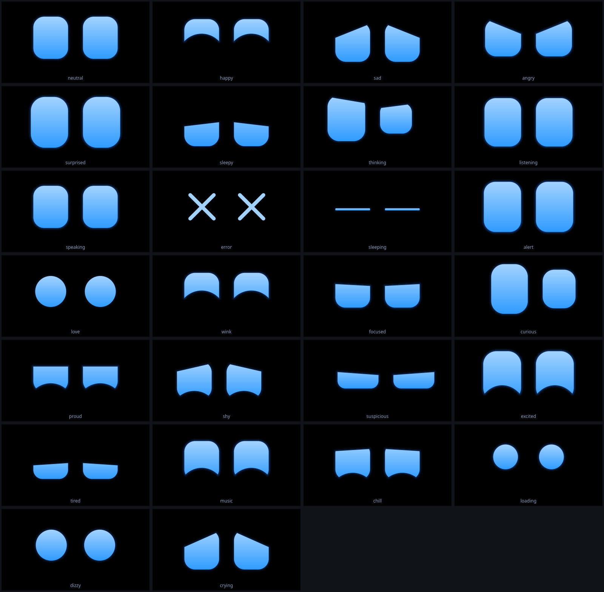

# ARIS Eyes — olhos digitais da ARIS para Linux

Olhos azuis animados, inspirados no Cozmo, que vivem na tela do seu computador:
**tela cheia** (fundo preto, olhos grandes), **miniatura** flutuante no canto, ou **escondidos**
sem encerrar o programa. É só a interface visual: não reconhece voz nem controla o PC.



## O que é e o que não é

- É um programa **independente** (pasta própria, processo próprio). Nada do seu projeto ARIS foi alterado.
- A ARIS principal vai controlá-lo por um canal local simples (`mood thinking`, `speech 0.6`...). Veja
  "Integrar com a ARIS".
- Expressões incluídas: `neutral`, `happy`, `sad`, `angry`, `surprised`, `sleepy`, `thinking`,
  `listening`, `speaking`, `error`, `sleeping`, `alert`. Comportamentos de vida: piscadas (às vezes duplas),
  olhadas em volta, respiração sutil, pulsar ao falar, tremida no erro. Para criar outra expressão, edite só
  `aris_eyes/eyes/presets.py`.

## Tecnologia escolhida: Python + PySide6 (Qt 6)

| Necessidade | Por que o PySide6 atende |
|---|---|
| Mesma linguagem da ARIS | Python: a integração futura é trivial |
| Janela sem bordas, tela cheia, translúcida | Suporte nativo do Qt em X11 e Wayland |
| Animação suave | `QPainter` com antialiasing e molas físicas; repinta só quando algo muda (pouca CPU) |
| Arrastar a miniatura | `startSystemMove()`: o próprio sistema move a janela, inclusive no Wayland |
| Instalação simples | `pip install PySide6` traz o Qt junto (sem compilar nada) |

Alternativas descartadas: **pygame** (sem janela sem borda/arrastar/bandeja decentes e já é usado pelo áudio
da ARIS), **tkinter** (sem antialiasing, ruim no Wayland), **Electron/web** (pesado demais para um olho que
fica aberto o dia todo).

Os olhos rodam em **processo separado** da ARIS de propósito: isola o Qt do áudio/pygame da ARIS e evita
conflitos de inicialização.

## Estrutura

```
aris_eyes/
├── aris-eyes.sh              inicia/comanda (usa o venv)
├── requirements.txt          PySide6
├── scripts/install.sh        cria o venv e instala (sem sudo)
├── scripts/render_preview.py gera docs/preview.png sem precisar de tela
├── scripts/render_extras_preview.py gera preview_extras.png e preview_scenes.png (galerias)
├── aris_eyes/
│   ├── app.py                argumentos, instância única, monta tudo
│   ├── config.py             padrões + ~/.config/aris_eyes/config.json
│   ├── modes.py              CONTROLE DOS MODOS (tela cheia / miniatura / escondida)
│   ├── shortcuts.py          atalhos de teclado configuráveis
│   ├── control.py            canal local (socket) de comandos
│   ├── client.py             cliente leve p/ a ARIS (só biblioteca padrão)
│   ├── api.py                interpreta os comandos
│   ├── tray.py               ícone de bandeja (opcional)
│   ├── eyes/
│   │   ├── presets.py        EXPRESSÕES (26 humores) + enfeites ligados a cada humor
│   │   ├── animator.py       SISTEMA DE ANIMAÇÃO (molas, piscar, olhar, fala) — sem Qt
│   │   ├── renderer.py       desenho dos olhos (QPainter)
│   │   ├── props.py          ENFEITES (notas, coração, fone...) — motor sem Qt
│   │   ├── props_renderer.py desenho dos enfeites (QPainter)
│   │   └── scenes.py         CENAS prontas (humor + enfeites + duração) — sem Qt
│   └── ui/
│       ├── eyes_widget.py    timer + pintura + eventos do mouse
│       └── window.py         JANELA: tela cheia, miniatura, escondida, arrastar, menu
└── tests/                    88 testes
```

## Dependências do sistema

O PySide6 traz o Qt, mas o Qt precisa de algumas bibliotecas do sistema para abrir janelas em X11.
Instale **só se aparecer** o erro `Could not load the Qt platform plugin "xcb"`:

```bash
# Ubuntu / Debian / Mint / Pop!_OS
sudo apt install libxcb-cursor0 libxkbcommon-x11-0 libxcb-icccm4 libxcb-image0 \
                 libxcb-keysyms1 libxcb-render-util0 libxcb-xinerama0 libxcb-xkb1
# Fedora
sudo dnf install xcb-util-cursor xcb-util-wm xcb-util-image xcb-util-keysyms xcb-util-renderutil libxkbcommon-x11
# Arch / Manjaro
sudo pacman -S xcb-util-cursor xcb-util-wm xcb-util-image xcb-util-keysyms xcb-util-renderutil libxkbcommon-x11
```

Bandeja do sistema: no **GNOME** é preciso a extensão "AppIndicator and KStatusNotifierItem Support".
Sem bandeja o programa funciona igual (use atalhos de teclado ou `--send`).

Nada disso mexe no seu sistema operacional nem no dual boot. O projeto só cria a pasta `.venv` dentro da
própria pasta e o arquivo `~/.config/aris_eyes/config.json`.

## Instalação

```bash
cd aris_eyes
./scripts/install.sh
```

(equivale a: `python3 -m venv .venv && .venv/bin/pip install -r requirements.txt`)

## Iniciar

```bash
./aris-eyes.sh               # tela cheia (modo configurado em start_mode)
./aris-eyes.sh --mini        # já na miniatura
./aris-eyes.sh --demo        # troca de expressão sozinho a cada 3 s, para você ver tudo
./aris-eyes.sh --check       # mostra se você está em X11 ou Wayland e se o PySide6 está ok
```

Rodar de novo com a interface já aberta não abre uma segunda: só traz a primeira de volta.

## Encerrar

Qualquer uma destas:
- `Ctrl+Q` com a janela em foco
- `Ctrl+C` no terminal onde iniciou
- botão direito nos olhos → **Sair**, ou ícone da bandeja → **Sair**
- `./aris-eyes.sh --send quit` (de outro terminal)

Fechar a janela (Alt+F4) só esconde, não encerra.

## Alternar entre tela cheia, miniatura e escondida

| Ação | Atalho (janela em foco) | Comando (funciona de qualquer lugar) |
|---|---|---|
| Tela cheia ⇄ miniatura | `F11` ou duplo clique | `--send toggle` |
| Ir para a miniatura | `Esc` | `--send mini` |
| Tela cheia | — | `--send fullscreen` |
| Esconder (programa continua rodando) | `Ctrl+H` | `--send hide` |
| Mostrar de novo | clique na bandeja | `--send show` |
| Ciclo: cheia → miniatura → escondida | `F10` | `--send cycle` |
| Sair | `Ctrl+Q` | `--send quit` |

Na **miniatura**: arraste com o botão esquerdo, gire a rodinha para aumentar/diminuir, botão direito abre o menu.
Em tela cheia o mouse some sozinho depois de 2 s parado.

### Atalhos de teclado configuráveis

Edite `~/.config/aris_eyes/config.json`, seção `shortcuts` (use `""` para desativar um atalho):

```json
"shortcuts": { "toggle_fullscreen": "F11", "mini": "Esc", "hide": "Ctrl+H", "cycle": "F10", "quit": "Ctrl+Q" }
```

Ações disponíveis: `toggle_fullscreen`, `mini`, `fullscreen`, `hide`, `cycle`, `quit`.
Teclas `1`–`9` e `0` trocam a expressão (para testar); desligue com `"dev_keys": false`.

### Atalhos GLOBAIS (com a interface escondida ou outro programa em foco)

Um programa comum **não consegue** capturar teclas globais no Wayland, e esconder a janela tira o foco dela.
A solução que funciona igual em X11 e Wayland é usar o atalho do próprio desktop chamando o comando:

- **GNOME:** Configurações → Teclado → Atalhos de teclado → Atalhos personalizados → `+`
- **KDE Plasma:** Configurações do sistema → Atalhos → Adicionar comando
- **XFCE / Cinnamon / MATE:** Teclado → Atalhos de aplicativos

Comando de cada atalho (troque pelo caminho real da pasta). Sugestões:

| Tecla sugerida | Comando |
|---|---|
| `Ctrl+Alt+E` | `/caminho/aris_eyes/aris-eyes.sh --send toggle` |
| `Ctrl+Alt+H` | `/caminho/aris_eyes/aris-eyes.sh --send cycle` |
| `Ctrl+Alt+M` | `/caminho/aris_eyes/aris-eyes.sh --send mini` |

## Expressões, enfeites e cenas (v2)

O menu (botão direito) agora tem três entradas: **Expressão** (os 12 humores clássicos),
**Mais expressões** (14 novos: apaixonado, piscadinha, orgulhoso, tonto...) e **Cenas**.

**Cena** = humor + enfeites com duração própria (sem tempo ela acaba sozinha e o rosto volta ao normal).
`scene spotify 10` mostra por 10 s; `scene off` encerra antes.

| Cena | O que aparece |
|---|---|
| `spotify` | notas musicais + equalizador |
| `fone` | fone de ouvido + notas |
| `dancar` | notas + brilhinhos |
| `apaixonado` | corações em volta dos olhos que viram coração |
| `piscadinha` | olho direito vira "^" |
| `timido` | bochechas rosadas |
| `chorando` | lágrimas escorrendo |
| `orgulhoso` | brilhinhos |
| `comemorar` | confete + olhos estrela |
| `tonto` | olhos em espiral |
| `nervoso` | gota de suor |
| `carregando` | três bolinhas pulando |
| `conectado` | ondas de sinal (Wi-Fi/ESP32) |
| `bateria` | bateria fraca piscando |
| `dormir` / `sono` | "Z z z" (olhos fechados / cansados) |
| `curioso` | "?" balançando |
| `alerta` | "!" pulsando |

Comandos novos (também via `./aris-eyes.sh --send "..."` e pela ponte da ARIS):

```bash
scene <nome> [segundos] | scene off    cena pronta (lista acima)
prop <nome> on|off [segundos]          enfeite avulso: notes, equalizer, headphones, hearts, zzz,
                                       sparkles, confetti, tears, sweat, question, exclaim, loading,
                                       blush, battery, signal, eye_heart, eye_spiral, eye_star, wink
music <0..1|off>                       volume da música (ritmo dos olhos / equalizador)
accent <#rrggbb|off>                   cor de destaque das notas/fone/equalizador
```

Humores novos ligam seus enfeites sozinhos (ex.: `mood apaixonado` → corações). Mudar de humor encerra
a cena e os enfeites. **Desligar tudo**: `"props_enabled": false` no config.json — os comandos acima
respondem `erro: ... desativados` e os olhos voltam ao comportamento antigo.

**Como criar um prop novo**: (1) defina a matemática em `eyes/props.py` e some o nome em `PROP_NAMES`;
(2) desenhe em `eyes/props_renderer.py`; (3) ligue a um humor em `MOOD_PROPS` (`eyes/presets.py`) ou a
uma cena em `eyes/scenes.py`; (4) teste em `tests/test_props.py` (matemática, sem tela).

## Configuração (`~/.config/aris_eyes/config.json`)

Criado na primeira execução. Valores inválidos são ignorados com aviso no terminal.

| Chave | Padrão | Para quê |
|---|---|---|
| `start_mode` | `fullscreen` | `fullscreen`, `mini` ou `hidden` |
| `eye_color`, `glow_color`, `background_color` | azul / azul / preto | cores `#rrggbb` |
| `mini_width`, `mini_height` | 300 × 170 | tamanho da miniatura |
| `mini_corner`, `mini_margin` | `bottom-right`, 24 | canto inicial (só X11) |
| `always_on_top` | `true` | miniatura acima das outras janelas (X11) |
| `skip_taskbar` | `true` | miniatura não aparece na barra de tarefas |
| `screen` | `-1` | `-1` = monitor atual; `0`, `1`... escolhe o monitor da tela cheia |
| `fps_fullscreen`, `fps_mini` | 60, 30 | quadros por segundo |
| `glow` | `true` | brilho em volta dos olhos (desligue em PC fraco) |
| `blink_min_s`, `blink_max_s` | 2, 6 | intervalo entre piscadas |
| `saccades`, `breathing` | `true` | olhadas em volta e respiração |
| `props_enabled` | `true` | enfeites e cenas; `false` = olhos como antes (sem cenas no menu) |
| `platform` | `auto` | `auto`, `xcb` (X11/XWayland) ou `wayland` |
| `tray`, `dev_keys` | `true` | bandeja; teclas 1–0 trocam expressão |

## Limitações do Linux (X11 × Wayland) e alternativas

Eu testei tudo em ambiente simulado (sem tela); o comportamento de janela abaixo é o padrão do Qt e dos
compositores, mas **não pude confirmar no seu desktop real**.

| Recurso | X11 (Xorg) | Wayland |
|---|---|---|
| Tela cheia, fundo preto, animações | ✅ | ✅ |
| Miniatura sem bordas, translúcida, cantos arredondados | ✅ (precisa de compositor, que todo desktop moderno tem) | ✅ |
| Arrastar a miniatura | ✅ | ✅ (o sistema move a janela) |
| Miniatura sempre no topo | ✅ | ❌ GNOME e KDE ignoram esse pedido de janelas comuns |
| Posição inicial/lembrada da miniatura | ✅ | ❌ o compositor escolhe onde abrir |
| Atalhos globais pelo próprio programa | ❌ (use os do desktop, acima) | ❌ (idem) |
| Ícone de bandeja | ✅ | ✅ (GNOME: extensão) |

**Alternativas se você usa Wayland e quer "sempre no topo" e posição fixa:**
1. Rode com `./aris-eyes.sh --x11` (ou `"platform": "xcb"` no config). Os olhos passam a rodar via XWayland,
   onde esses recursos funcionam. Custo: a imagem pode ficar um pouco menos nítida com escala fracionária.
2. Ou fixe manualmente: GNOME → `Alt+Espaço` na miniatura → "Sempre no topo"; KDE → `Alt+F3` → "Manter acima".
3. Ou escolha "Xorg" na tela de login (engrenagem).

Para saber o que você está usando: `./aris-eyes.sh --check`.

## Integrar com a ARIS (próxima etapa)

A ARIS principal só precisa mandar texto para o socket local. O `client.py` usa **apenas a biblioteca
padrão**, então funciona no ambiente da ARIS sem instalar o PySide6:

```python
import sys; sys.path.append("/caminho/aris_eyes")      # ou copie aris_eyes/client.py para o projeto da ARIS
from aris_eyes.client import send

send("state thinking")   # -> "ok"   (None se os olhos não estiverem rodando: nunca derruba a ARIS)
send("speech 0.6")       # volume da fala em 0..1 (ligue ao nível do áudio do TTS)
send("speech off")       # volta à fala simulada
```

Sugestão de mapeamento dos estados da ARIS (fica no lado da ARIS, em um único lugar):

| Estado da ARIS | Comando |
|---|---|
| ocioso | `state neutral` |
| ouviu "aris" | `state listening` |
| pensando / executando | `state thinking` |
| falando | `state speaking` (+ `speech <volume>` se tiver o nível do áudio) |
| sucesso | `state happy` |
| erro | `state error` |
| pede confirmação de ação sensível | `state alert` |
| madrugada / sem uso | `state sleepy` / `state sleeping` |

Lista completa de comandos: `./aris-eyes.sh --send help`.
A ARIS também pode iniciar os olhos sozinha: `subprocess.Popen(["/caminho/aris_eyes/aris-eyes.sh", "--mini"])`.

Segurança do canal: o socket fica em `$XDG_RUNTIME_DIR` (só o seu usuário acessa) e aceita apenas a lista
fixa de comandos de aparência/modo; não executa comandos de shell nem controla o computador.

## Testes

```bash
.venv/bin/pip install -r requirements-dev.txt
.venv/bin/python -m pytest -q          # roda sem tela (plataforma offscreen)
```

## Problemas comuns

- **`Could not load the Qt platform plugin "xcb"`** → instale as bibliotecas da seção "Dependências do sistema".
  Para ver qual falta: `QT_DEBUG_PLUGINS=1 ./aris-eyes.sh 2>&1 | grep -i "cannot\|not found"`.
- **Muita CPU** → em `config.json`: `"glow": false` e/ou `"fps_fullscreen": 30`.
- **Interface sumiu** → `./aris-eyes.sh --send show` (ou rode `./aris-eyes.sh` de novo).
- **Miniatura não fica no topo / não aparece onde configurei** → você está no Wayland; veja a tabela acima.
- **Desinstalar** → apague a pasta do projeto e `~/.config/aris_eyes/`. Nada mais foi alterado.
